# ESP32-CAM ＋ 小智：拍照 MCP（區網版）

讓小智聽到「幫我拍一張照片」，就用 ESP32-CAM 拍照，還能說出照片裡有什麼。

- **不需要網域、不需要固定 IP、不需要開防火牆。**
- 只要一台放在教室的電腦（Windows／Mac 都可以），跟 ESP32-CAM 連到同一個 Wi-Fi。

## 運作方式

```text
小智（雲端）
   ▲  wss 連線（由老師電腦「主動連出去」，所以不用網域）
   │
老師電腦：xiaozhi_bridge.py ──► ezcam_mcp.py
                                      │  區網 http
                                      ▼
                                 ESP32-CAM（http://ezcam.local）
```

- ESP32-CAM 只在區網提供照片，外面連不到它。
- 老師電腦主動連線到小智雲端，小智再透過這條連線叫電腦拍照。
- **老師電腦要一直開著，程式視窗也不能關。**

## 需要準備

| 項目 | 說明 |
|---|---|
| ESP32-CAM | AI-Thinker 板（最常見那款），要有 USB 燒錄座（ESP32-CAM-MB）或 USB 轉 TTL |
| 小智 | 已經在小智控制台綁好裝置 |
| 一台電腦 | Python 3.10 以上，跟 ESP32-CAM 連同一個 Wi-Fi |
| Wi-Fi | **2.4 GHz**（ESP32 不支援 5 GHz）。不能用要網頁登入的校園 Wi-Fi；手機熱點可以 |
| OpenAI API key | 選用。有它小智才「看得懂」照片；沒有也能拍照 |

## 下載

右上角綠色 **Code → Download ZIP**，解壓縮後會有：

```text
firmware/ezcam_lan/ezcam_lan.ino   ESP32-CAM 韌體
mcp/ezcam_mcp.py                   拍照 MCP server（三個工具）
mcp/xiaozhi_bridge.py              把 MCP 接到小智（斷線自動重連）
mcp/requirements.txt               Python 套件
mcp/.env.example                   設定檔範本
```

---

## 步驟 1：燒錄 ESP32-CAM

### 1-1 安裝 Arduino IDE，加入 ESP32 開發板網址

1. 安裝 [Arduino IDE 2](https://www.arduino.cc/en/software)。
2. 打開 **檔案 → 喜好設定**（Mac：**Arduino IDE → 設定**）。
3. 在 **其他開發版管理員網址** 貼上下面這串，按 **確定**：

   ```text
   https://espressif.github.io/arduino-esp32/package_esp32_index.json
   ```

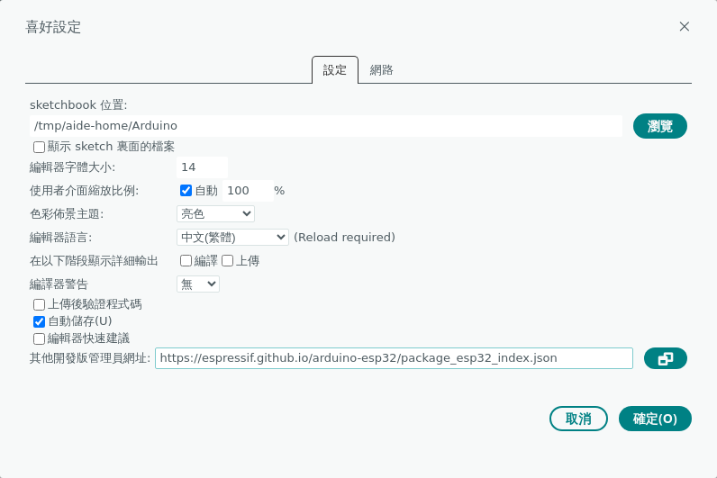

> 介面是英文的話，可以在同一個視窗的「編輯器語言」改成 **中文(繁體)**。

### 1-2 安裝 ESP32 開發板

1. 點左邊第二個圖示 **開發板管理員**，搜尋 `esp32`。
2. 會出現兩個，**要裝下面那個「esp32 提供者：Espressif Systems」**，不是上面的「Arduino ESP32 Boards」。

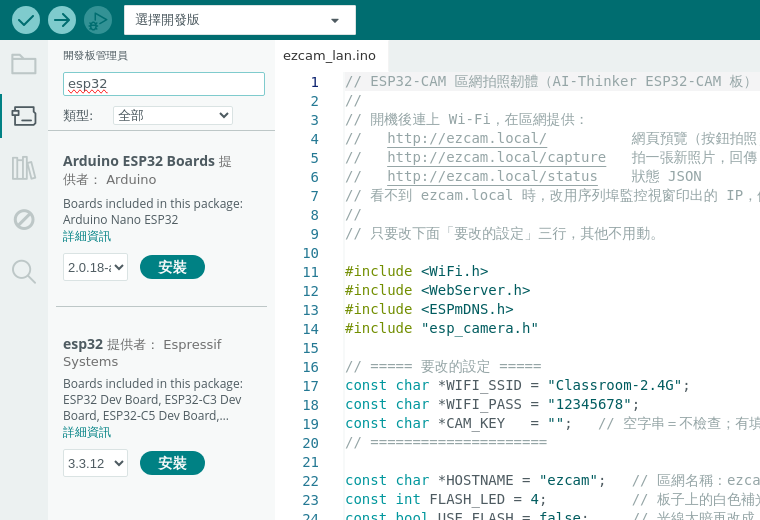

3. 按 **安裝**，要下載幾百 MB，等幾分鐘。看到 **已安裝** 就好了。

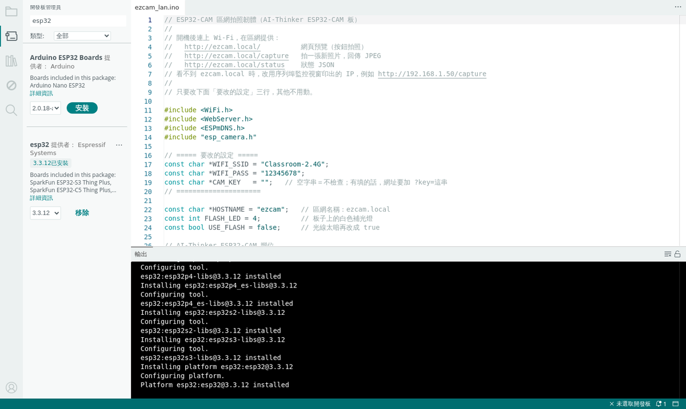

### 1-3 打開韌體，改 Wi-Fi

1. 用 Arduino IDE 打開 `firmware/ezcam_lan/ezcam_lan.ino`。
2. 只改最上面「要改的設定」三行：

   ```cpp
   const char *WIFI_SSID = "教室WiFi名稱";
   const char *WIFI_PASS = "教室WiFi密碼";
   const char *CAM_KEY   = "";   // 想防學生亂連可以填一串密碼；不填也可以
   ```

### 1-4 選開發板與連接埠

1. 用 USB 把 ESP32-CAM 接上電腦。
2. 點上方 **選擇開發版 → 選擇其他開發板及連接埠**。
3. 左邊搜尋 `ai thinker`，選 **AI Thinker ESP32-CAM**。
4. 右邊選 ESP32-CAM 的連接埠，按 **確定**。
   - Windows 通常是 `COM3`、`COM4`…
   - Mac 通常是 `/dev/cu.usbserial-…` 或 `/dev/cu.wchusbserial-…`
   - 不知道是哪個？拔掉 USB 看哪個消失，就是它。

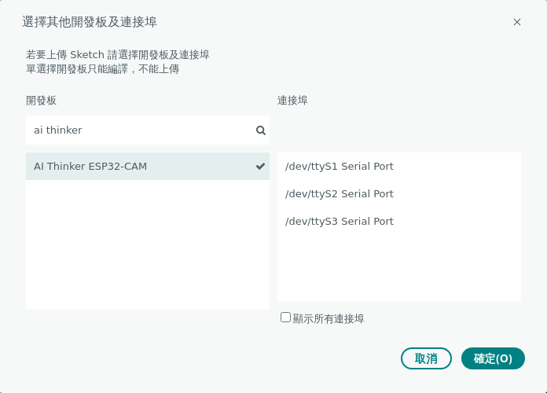

> 截圖是在沒有接板子的電腦上拍的，所以右邊的連接埠名稱跟你看到的不一樣。

### 1-5 上傳

1. 先按左上角 **✓ 驗證**，下面出現 `Sketch uses … bytes` 就是程式沒問題。

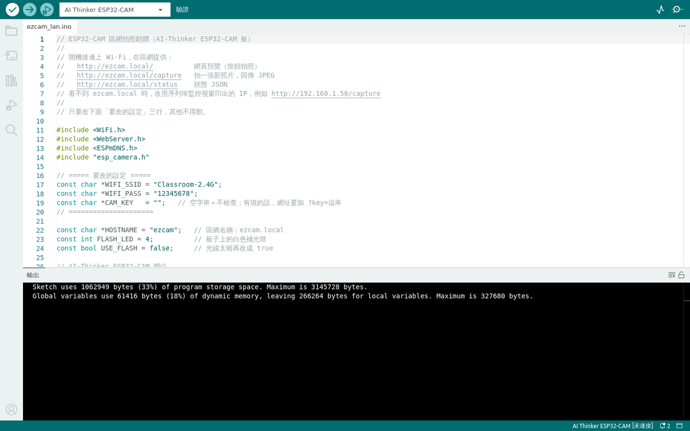

2. 再按旁邊的 **→ 上傳**。
   - 用 ESP32-CAM-MB 燒錄座：直接上傳即可。
   - 卡在 `Connecting....`：按住板子上的 **IO0** 鍵，再按一下 **RST**，然後放開 IO0。

### 1-6 抄下相機的 IP

1. 點右上角放大鏡 **序列埠監控視窗**，右下角速率選 **115200**。
2. 按一下板子上的 **RST**，會看到：

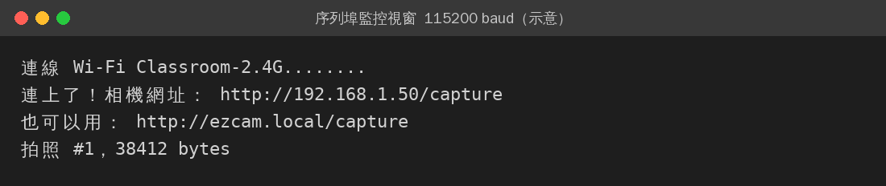

**把 `192.168.x.x` 這串 IP 抄下來**，等一下會用到。

> 這張是依照韌體實際會印的文字畫的示意圖；你的 Wi-Fi 名稱和 IP 會不一樣。

### 驗收：用瀏覽器看看相機

用同一個 Wi-Fi 的電腦或手機打開 `http://ezcam.local/`（打不開就用 `http://抄下來的IP/`），按「拍照」能看到畫面就成功了。

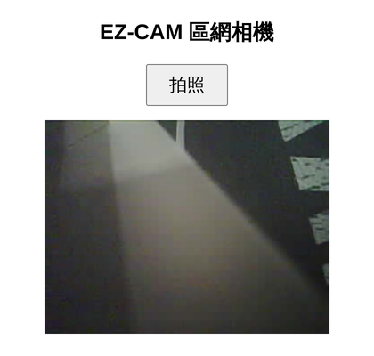

---

## 步驟 2：在電腦上安裝拍照程式

1. 安裝 [Python](https://www.python.org/downloads/)。**Windows 安裝時記得勾「Add Python to PATH」**。
2. 把 `mcp` 資料夾整個複製到電腦，例如桌面。
3. 打開終端機（Windows 用「命令提示字元」），輸入：

   **Mac**

   ```bash
   cd ~/Desktop/mcp
   python3 -m venv .venv
   source .venv/bin/activate
   pip install -r requirements.txt
   ```

   **Windows**

   ```bat
   cd %USERPROFILE%\Desktop\mcp
   python -m venv .venv
   .venv\Scripts\activate
   pip install -r requirements.txt
   ```

看到 `Successfully installed` 就裝好了：

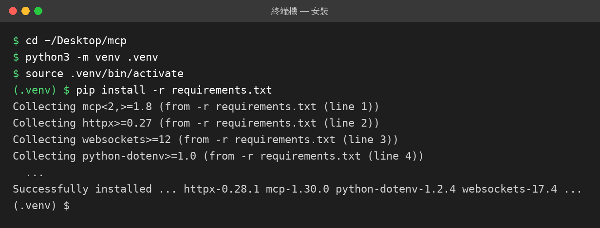

## 步驟 3：拿小智的 MCP 接入點

1. 登入小智控制台，進入 **智能體**。
2. 在你的智能體按 **配置**，切到 **擴充能力** 分頁。
3. 往下找到 **自定義服務 → MCP接入點**，按右邊的 **複製** 圖示，複製整串 `wss://api.xiaozhi.me/mcp/?token=…`。

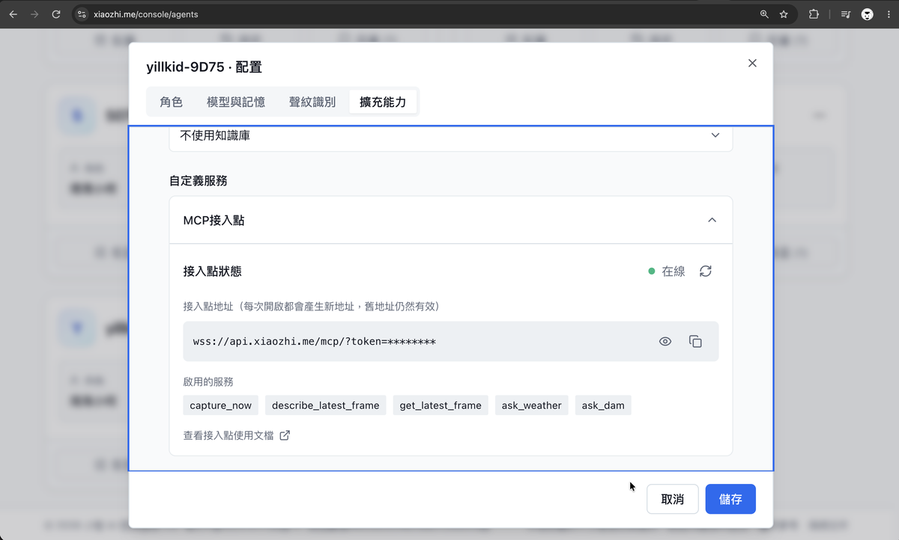

- **這串等於密碼**：不要貼到群組、簡報或 GitHub。
- 截圖是另一套工具接上時的樣子。用這份套件接上後，「啟用的服務」會顯示 `capture_now`、`describe_photo`、`camera_status`。

## 步驟 4：填設定檔

把 `mcp` 資料夾裡的 `.env.example` 複製一份，改名成 `.env`，用記事本打開後填入：

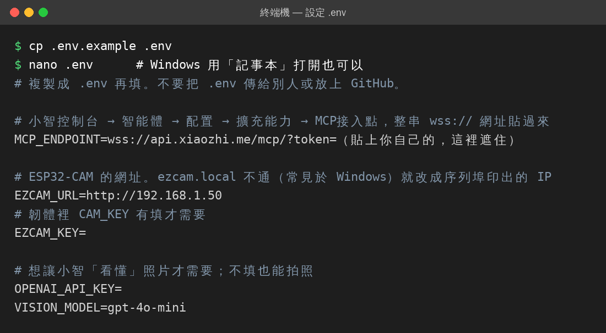

| 欄位 | 填什麼 |
|---|---|
| `MCP_ENDPOINT` | 步驟 3 複製的整串 `wss://…` |
| `EZCAM_URL` | `http://ezcam.local`；**Windows 常常不認得，直接填步驟 1-6 抄的 IP**，例如 `http://192.168.1.50` |
| `EZCAM_KEY` | 韌體的 `CAM_KEY` 有填才要填，填一樣的 |
| `OPENAI_API_KEY` | 想讓小智描述照片內容才要填 |

> Windows 檔案總管預設會藏起副檔名。改名時請確認檔名是 `.env`，不是 `.env.txt`。

## 步驟 5：啟動

在步驟 2 的終端機（前面有 `(.venv)` 的那個）輸入：

```bash
python xiaozhi_bridge.py
```

看到「**已連上小智，相機工具上線**」就接好了。之後小智每次拍照，這裡都會多一行紀錄：

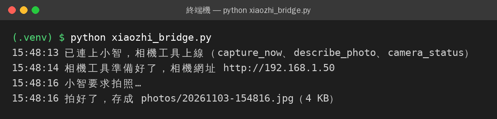

回到小智控制台的 MCP接入點，按重新整理，狀態應該是 **在線**。

## 步驟 6：跟小智說話

- 「幫我拍一張照片」→ 小智拍照
- 「照片裡有什麼？」→ 小智描述最新照片（需要 OpenAI key）
- 「相機還好嗎？」→ 檢查相機連線

拍下的照片都會存在電腦的 `mcp/photos/` 資料夾。

> 小智只用文字回答、沒有真的拍照？到控制台的 **角色** 分頁，在角色介紹加一句：
> 「使用者要你拍照時，一定要呼叫 capture_now 工具；問照片內容時呼叫 describe_photo。」

---

## 常見問題

| 狀況 | 原因與解法 |
|---|---|
| 序列埠一直印 `.....` 連不上 | Wi-Fi 是 5 GHz、密碼打錯，或是要網頁登入的 Wi-Fi。換 2.4 GHz 或用手機熱點 |
| 序列埠印 `相機啟動失敗` | 相機排線沒插好。關電，把排線的黑色卡榫掀起來重插 |
| 序列埠是亂碼 | 右下角速率沒選 115200 |
| 小智說「連不到相機」 | 電腦跟 ESP32-CAM 不在同一個 Wi-Fi；或 `ezcam.local` 不通，改填 IP |
| IP 隔天變了 | 在 Wi-Fi 分享器設定「DHCP 保留／固定 IP」；或每次看序列埠的 IP 再改 `.env` |
| 照片太暗 | 韌體裡 `USE_FLASH` 改成 `true` 重新上傳，會開補光燈 |
| 板子一直重開機 | 電源不夠。換一條好的 USB 線，或用 5V 2A 的電源 |
| 啟動時說要設定 `MCP_ENDPOINT` | `.env` 沒填好，或檔名其實是 `.env.txt` |
| 視窗關掉後小智就不能拍了 | 正常。這個程式要一直開著，電腦也不能睡眠 |

## 安全提醒

- `MCP_ENDPOINT`、`OPENAI_API_KEY` 只放在 `.env`，不要分享。`.gitignore` 已經排除 `.env`。
- ESP32-CAM 只在區網提供照片，沒有開放到網路上。不過在共用的校園網路裡，同網段的人都連得到 `http://ezcam.local/`；介意的話，在韌體填 `CAM_KEY`。

## 授權

MIT
